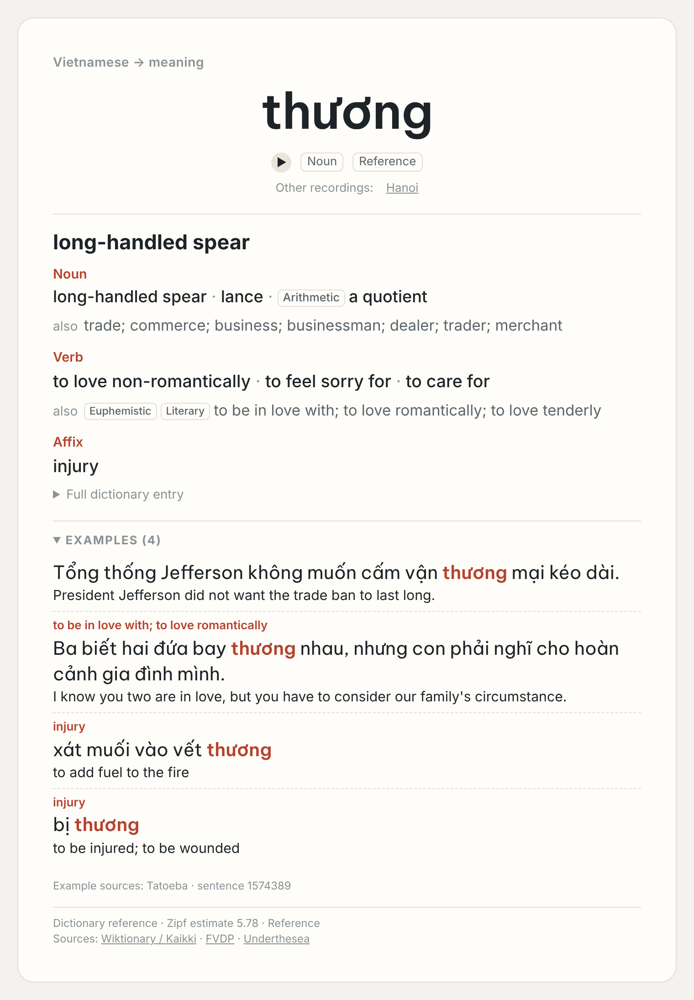
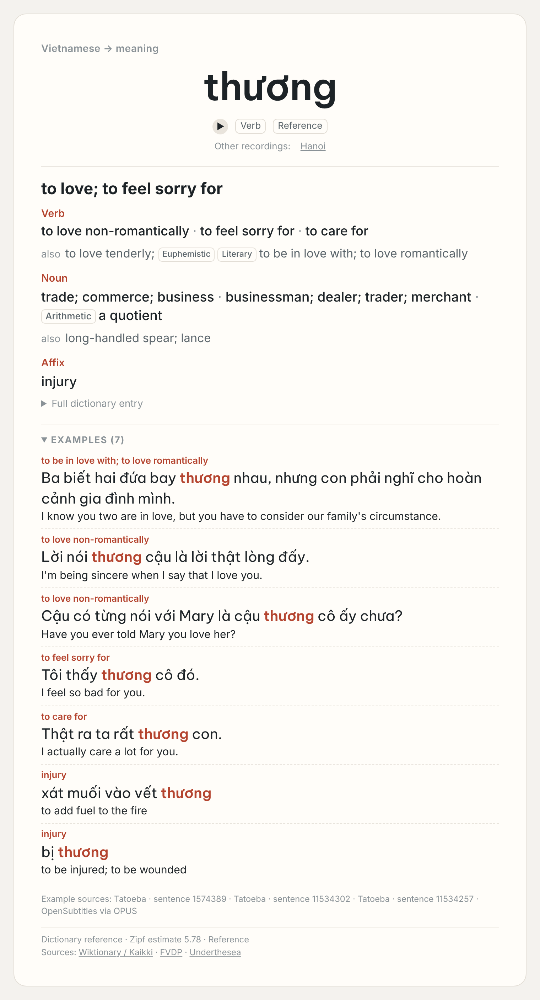
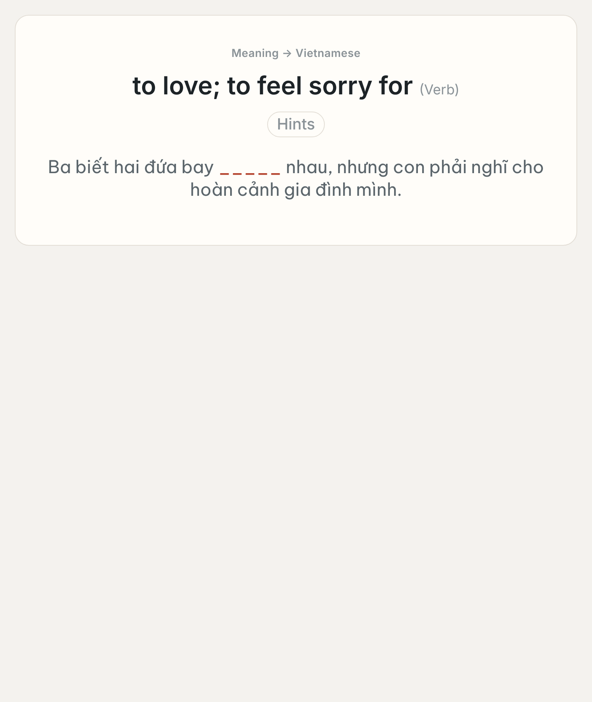
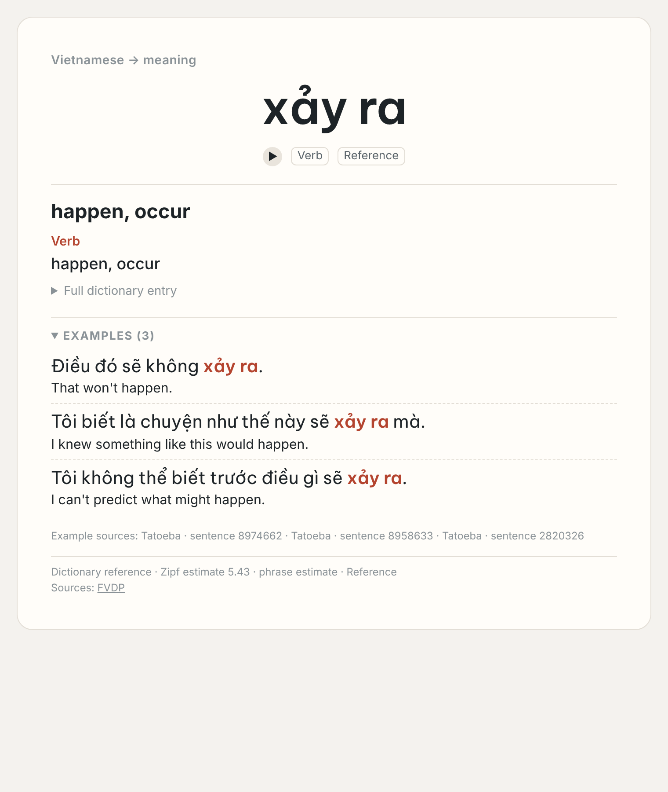
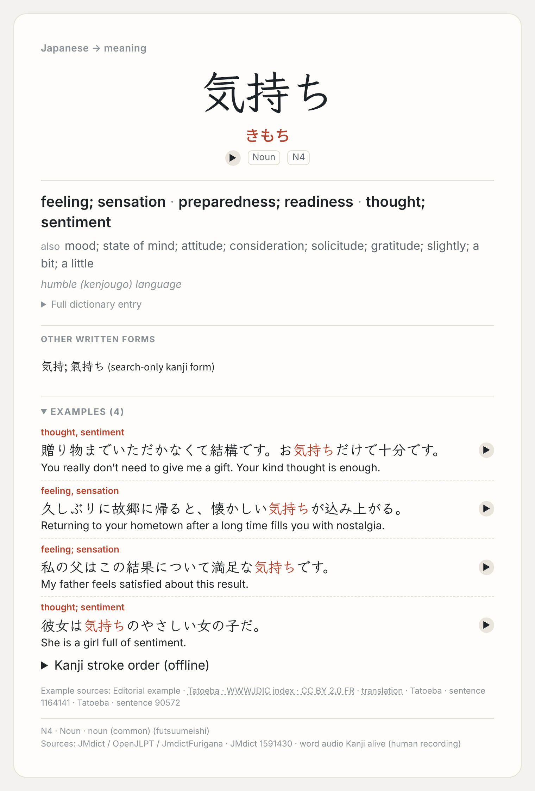
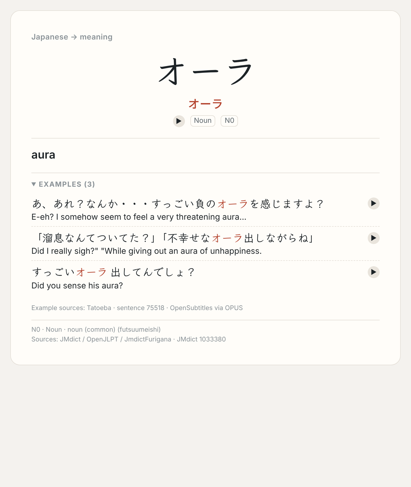
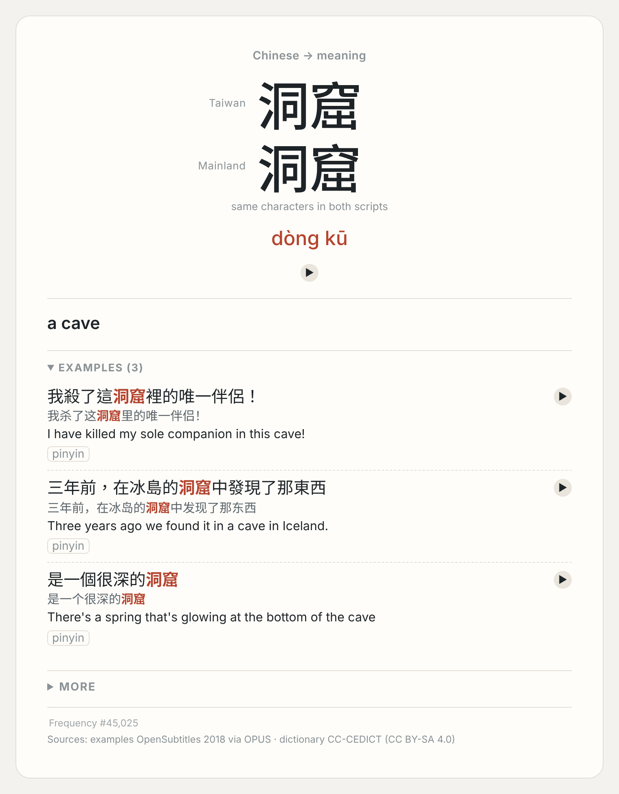
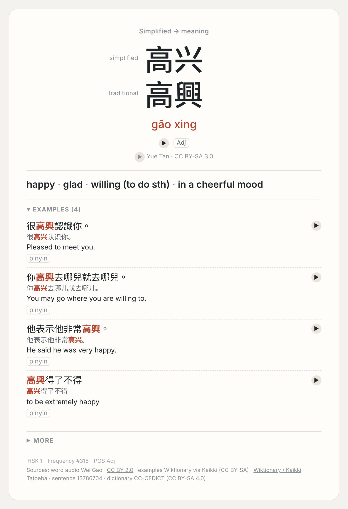
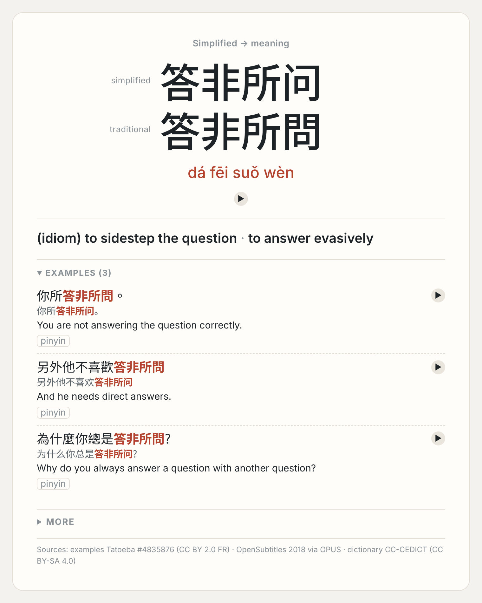

# Language decks: Vietnamese, Japanese, Chinese

Content updates for three large Anki vocabulary decks: better main meanings, many more example sentences and
new words. The updates are applied inside Anki with the
[Card Redesign](https://github.com/0Duc0/anki-card-redesign) add-on, which keeps your own notes and your learning
progress exactly as they are.

**Downloads:** [latest release](../../releases/latest) – one update file per language (`*.json.gz`).

## What the 2026-11-20 updates change

### Vietnamese

| | |
|---|---|
| Notes improved | **22,221** |
| Example sentences added | **44,117** (19,022 words), each labelled with the meaning it shows |
| Wrong examples removed | 634 (the word only appeared inside a longer word, e.g. *thương* in *thương mại*) |
| Meanings re-ordered by real usage | 2,160 words (450 of the 700 most frequent checked by hand) |
| Main meaning (gloss) fixed | 5,862 – e.g. *thương* is “to love; to feel sorry for”, not “long-handled spear”; “synonym of …” and “alternative form of …” replaced by the actual meaning |
| New words | **2,882**: 1,508 from FVDP, 1,180 that only had a Vietnamese definition (English meaning written by hand), 194 place names |

| Before | After |
|---|---|
|  |  |

Production card (English → Vietnamese) with the new context hint, and a new word:

| | |
|---|---|
|  |  |

### Japanese

- Example sentences for **56,115** more words (Tatoeba first, then TED talks, then subtitles), up to three per
  word, labelled with the meaning, with text-to-speech.
- Conjugated forms count: 食べた and 食べない are examples for 食べる.

| | |
|---|---|
|  |  |

### Chinese

- Example sentences for **59,344** more words; words without any example: 91,225 → 56,432.
- Every example shows Taiwan-standard traditional and simplified characters, the word highlighted in both,
  English, pinyin behind a button and text-to-speech. Existing examples are kept as they were.

| | | |
|---|---|---|
|  |  |  |

Heisig decks are not touched.

## How to apply an update

1. Install or update **Card Redesign** (2.0 or newer) from its
   [release page](https://github.com/0Duc0/anki-card-redesign/releases/latest) and restart Anki.
2. Download the update file for your language.
3. *Tools › Card redesign… › Deck update › Choose file…*, then **Check**. The check shows what would change and
   writes nothing.
4. **Back up and apply**. Anki makes a full backup first. The Vietnamese update takes about 15 seconds.
5. Sync as usual – no full sync is needed.

What is guaranteed:

- Your own fields (`PersonalNotes`, `Notizen`, `Mnemonic`, …) are never written.
- A field you edited yourself is left alone: the update only replaces text that is still exactly what it was
  made from.
- Review history, due dates, intervals, tags, flags and decks of existing cards do not change.
- New words go into the deck you choose in the dialog (default: *99 Dictionary Reference*).
- Applying an update twice changes nothing. *Undo an update…* puts everything back.

Details: [docs/pack-format.md](docs/pack-format.md).

## Sources

Tatoeba, TED2020 and OpenSubtitles (via OPUS) for example sentences; Wiktionary/Kaikki, FVDP, Underthesea,
JMdict and CC-CEDICT for meanings. Licenses and how the sentences are chosen: [docs/sources.md](docs/sources.md).
For personal study only (TED2020 is non-commercial).

## Rebuilding the updates

The pipeline needs copies of the collections (exported from Anki) and the raw corpora. Neither is committed.

```
pip install anki fugashi unidic-lite jieba opencc-python-reimplemented
tools/download_corpora.sh                       # → corpora/
python pipeline/corpora.py vi ja zh            # → data/corpus/<lang>.tsv.gz (cleaned pairs)
export DECKS=/path/to/collections              # vn.anki2, jp.anki2, cn_raw.anki2
export CARD_REDESIGN=/path/to/anki-card-redesign/card_redesign

# Vietnamese
python pipeline/vietnamese/scan.py             # sentence evidence per word and meaning
python pipeline/vietnamese/improve.py          # meanings, order, glosses, examples, hints
python pipeline/vietnamese/new_notes.py        # new words
python pipeline/vietnamese/make_pack.py        # → dist/vietnamese-update-<date>.json.gz

# Japanese and Chinese
python pipeline/japanese/examples.py
python pipeline/chinese/examples.py
python pipeline/make_cjk_packs.py              # → dist/japanese-…, dist/chinese-…

python tools/screenshots.py                    # card screenshots (Playwright + Chrome)
```

| Path | |
|---|---|
| `pipeline/corpora.py` | download → cleaned sentence pairs |
| `pipeline/english.py` | English keyword and head-word matching for meaning labels |
| `pipeline/pack.py` | writes update files |
| `pipeline/vietnamese/` | segmentation (`seg.py`), deck reader, scan, improvements, new words; `v8/` is the deck's original builder |
| `pipeline/japanese/`, `pipeline/chinese/` | example sentence selection |
| `data/curated/` | hand-written glosses and meaning order (Vietnamese) |

## License

The code is a personal project, no license granted. The data keeps the licenses of its sources
([docs/sources.md](docs/sources.md)).
